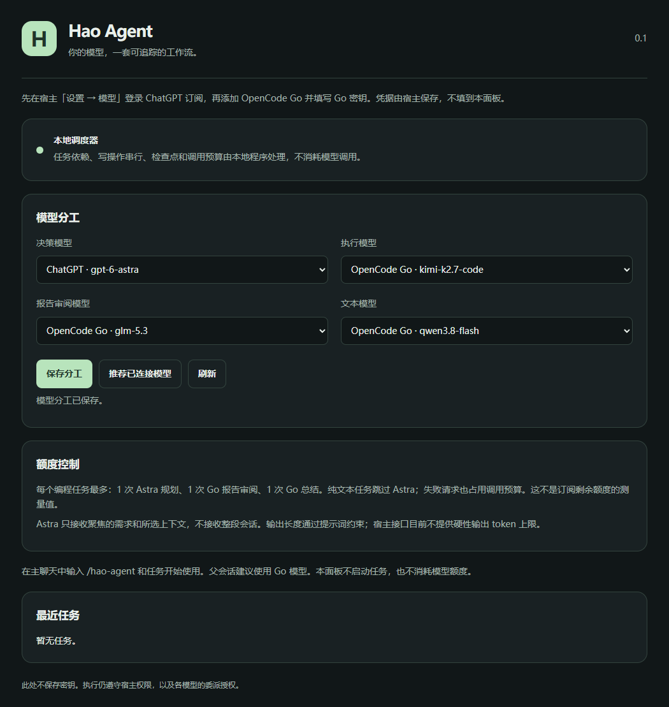

# Hao Agent

A personal desktop agent built on [PI-Desktop](https://github.com/vastsa/PI-Desktop),
with a local scheduler, a focused GPT-6 Astra decision stage, and OpenCode Go
execution, report review, and writing models.

This repository contains the upstream desktop source and the Hao Agent extension.
The Windows launcher currently uses the official PI-Desktop 0.20.1 portable
host. It is not an independently rebuilt or signed desktop application.



*Workbench rendered with test fixtures. The image does not show a signed-in account.*

## Model roles

| Role | Initial preference | Purpose |
| --- | --- | --- |
| Scheduler | Local deterministic code | Dependencies, checkpoints, deduplication, concurrency and call limits |
| Decision | ChatGPT subscription: GPT-6 Astra | One focused plan per coding job; low reasoning when supported |
| Execution | OpenCode Go: Kimi K2.7 Code | Project tools, focused changes and verification |
| Report review | OpenCode Go: GLM-5.3 | Check worker reports for findings and missing evidence |
| Text | OpenCode Go: Qwen3.8 Flash | Writing tasks and the final summary |

These are starting preferences, not benchmark results. Assignments use the
host's connected-model catalog; unavailable models are never fabricated or
silently substituted. Subscription access depends on the account and provider.
See [OpenCode Go](https://opencode.ai/v2/docs/console/go/) and
[Sign in with ChatGPT](https://learn.chatgpt.com/docs/sign-in-with-chatgpt).

## What is implemented

- Validated task dependency graphs with at most six execution tasks.
- Up to two declared-read workers; file-writing tasks run alone.
- One Astra plan per coding job, followed by Go execution, one report review,
  and one summary. Text-only requests skip Astra.
- Persisted call reservations before model requests, including failed requests.
- Duplicate-request detection, exact-delivery tracking and restart recovery.
- No automatic premium retries; uncertain dispatches and interrupted completions pause.
- Parent-session ownership, worker recursion protection and scoped cancellation.
- A Chinese/English model workbench using the host's plugin permission boundary.
- A Windows BAT launcher with application profiles, caches and temporary files
  kept beside the checkout on D when installed there.

## Windows quick start

Requirements: Windows x64, Git, Node.js 24 or newer, a ChatGPT account with the
requested model available, and an OpenCode Go subscription. No Rust compiler or
full desktop dependency installation is required for the plugin workflow.

Clone this repository into a D-drive folder, then run:

```powershell
git clone https://github.com/huanmi56/hao-agent.git D:\Projects\hao-agent
cd D:\Projects\hao-agent
node scripts/build-hao-agent.mjs
node scripts/download-hao-host.mjs
```

The downloader obtains the pinned upstream Windows portable release and checks
its SHA-256 before extracting. Generated packages, downloads and runtime data
are ignored by Git and stay in `distribution/`.

With PI-Desktop closed, install and enable the plugin:

```powershell
node scripts/install-hao-agent.mjs
.\Hao-Agent.bat
```

The installer backs up the existing plugin registry and grants the six
capabilities declared in the included manifest. It uses the official host
installation API; it does not read credentials or call any model. To review
permissions manually instead, start the host and import
`distribution/local.hao-agent-0.1.0.piplug` from its Plugins page.

## Connect your subscriptions

1. In the running application, press **Ctrl+,**, or click the bottom-left gear,
   then choose **Models**. Use the host's ChatGPT vendor sign-in and add the
   OpenCode Go preset with your Go key. Never put passwords, keys or tokens in
   this repository or the workbench.
2. Enable the execution model for delegation in the host's Models settings.
3. Return to the application, open **Plugins → Installed → Hao Agent → Open
   panel**, suggest connected models, inspect the selections and save them.
   The host window is still titled **PI-Desktop**; the workbench is a plugin panel.
4. Use a Go model for the parent chat. Invoke the `hao-agent` skill through the
   host's slash/skill picker and describe the task and acceptance criteria.

The parent inspects the returned plan before dispatching work. Completion
notices resume dependency processing. Review findings or verification gaps
withhold the final success summary.

Always launch through `Hao-Agent.bat` to retain the separate data location.
Windows still owns its credential store and normal OS bookkeeping. No existing
Codex installation or system-wide environment variables are changed.

## Budget and verification limits

- Call limits count logical completions, not subscription credits or physical
  HTTP attempts. The host may retry transient failures inside a completion.
- Worker sessions and the parent chat consume their own normal model usage.
- The plugin cannot measure remaining ChatGPT or Go subscription quota.
- Planner input is bounded to 12,000 request characters and 6,000 context
  characters. Full conversation history is excluded. Output length is a prompt
  request because the public host API has no hard output-token limit.
- Review checks bounded worker reports, not repository files independently.
  Read-only task declarations do not create an OS-level sandbox.
- No real-account performance, latency or accuracy benchmark is claimed.

## Development and tests

```powershell
node --test examples/plugins/hao-agent/test/*.test.cjs
node scripts/build-hao-agent.mjs
node --test scripts/hao-agent-host.test.mjs
```

The native-host integration test requires the downloaded portable release.
For rendered desktop/mobile panel tests, provide an installed Playwright module
and browser through `HAO_PLAYWRIGHT_PATH` and `HAO_BROWSER_PATH`, then run:

```powershell
node --test scripts/hao-agent-panel.test.mjs
```

The 25 initial automated checks cover workflows, native package installation,
the actual isolated plugin process and rendered panel behavior. Provider calls
are mocked. Subscription authentication and paid end-to-end execution remain
manual acceptance checks. Packaging runs the upstream SDK/devkit through
Node's TypeScript transform; it is not full application typechecking.

## Repository guide

| Path | Contents |
| --- | --- |
| `examples/plugins/hao-agent/` | Scheduler, model routing, plugin entry, panel, skill and tests |
| `scripts/*hao*.mjs` | Packaging, portable-host download, installation and integration tests |
| `Hao-Agent.bat` | Windows launcher with a separate local profile |
| [PERSONAL-AGENT.md](PERSONAL-AGENT.md) | Detailed setup, model choices and limitations |
| [Workflow specification](docs/spec/07-plugins/hao-agent-personal-workflow.md) | Extension behavior and boundaries |
| [Upstream README](README.upstream.md) | Original desktop features and full application build instructions |

## Attribution and license

Hao Agent derives from [vastsa/PI-Desktop](https://github.com/vastsa/PI-Desktop).
Original source history, attribution and license notices are retained. The
repository is distributed under the inherited [LGPL-3.0 license](LICENSE).
Provider trademarks and subscription services belong to their respective owners.

Do not publish `distribution/`, local account data, keys, access tokens, logs or
private project content. This repository contains source and a fixture screenshot;
download the official desktop binary separately.
